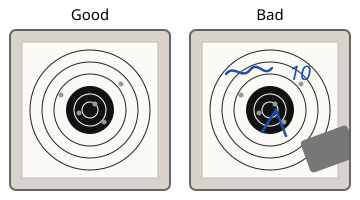
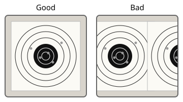
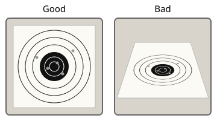
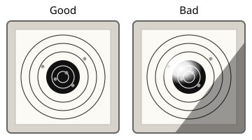
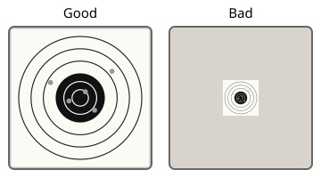
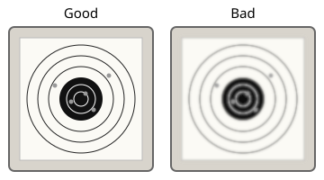

# Taking a photo the app can score

Six rules for the photo you add to a sheet on the Shot groups page, so that hole detection finds the target and its holes with few corrections. Each rule names the quality note the app shows when a photo breaks it; one rule is not checked by the app at all.

The quality check says what makes holes hard to find in a photo. It never says that a photo is good or that a detection is right, so look over the proposed holes before you accept them. The measures and their limits are on the model page [Hole detection](models/hole-detection.md#photo-quality).

## 1. Nothing on the face

Photograph the target before you write on it, and keep clips, stickers and fingers off the face. Writing and covered rings hide holes or look like them.

In-app note: none. The check cannot see writing, drawings or anything covering the face.

## 2. One target, all of it

Frame one target with a strip of paper around it, and cover or fold away a neighbouring target. A photo with several possible targets goes on in the guided steps instead of detecting at once.

In-app note: "The black area of the target is cut off by the edge of the photo." It is shown only while no target is selected or recognised, since a photo may show only the centre of a known target. The check does not see a second target in the frame.

## 3. Straight from above, no slant

Hold the camera parallel to the paper, straight above the centre of the target. A slant squeezes the rings and moves the holes.

In-app note: "The target is photographed at a slant of about N degrees."

## 4. Even light, no reflection

Light the target from the side or with daylight, with no flash straight on and no shadow of your hand or phone on the sheet.

In-app notes:

- "A bright reflection covers part of the paper."
- "The light is uneven: one side of the target is much darker than another."
- "The black area and the paper are close in brightness."
- "The photo is dark: even its brightest part is dim."
- "The black zones of the target look grey."

## 5. Close enough

Let the target fill most of the frame and use the full resolution of the camera, so that a hole is several pixels across.

In-app notes: "A bullet hole is only about N px across in this photo." or, for a target without a black area, "The photo is only N px on its longer side."

## 6. Steady, not soft

Rest the camera or your elbows, tap the target on the screen to focus, then take the photo.

In-app note: "The photo is soft: the edges of the target are blurred."
